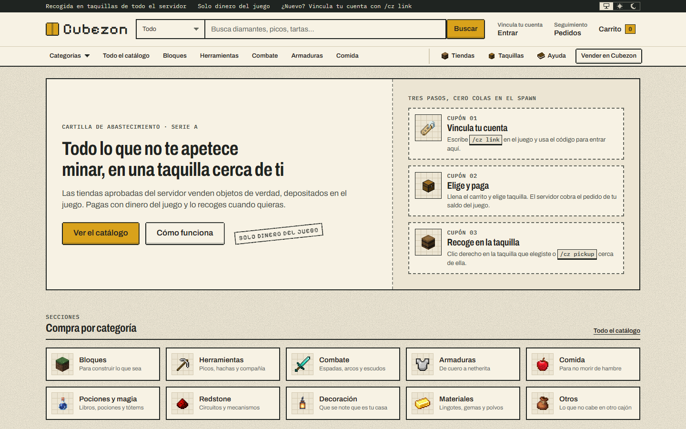
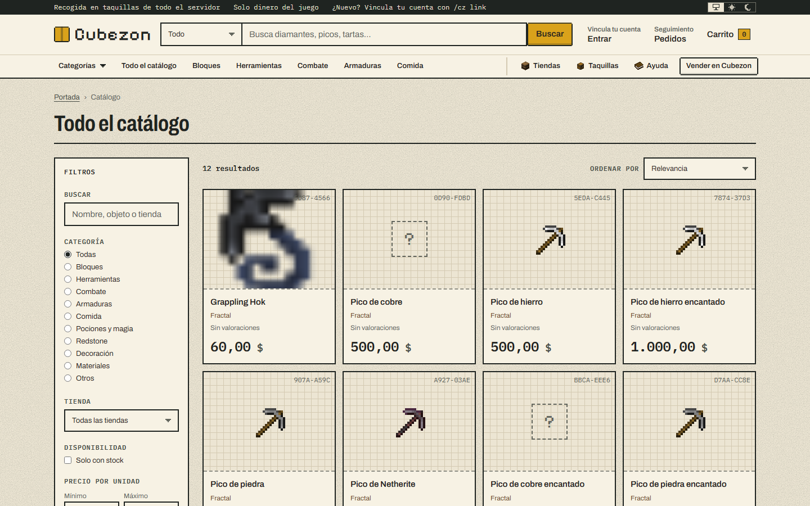
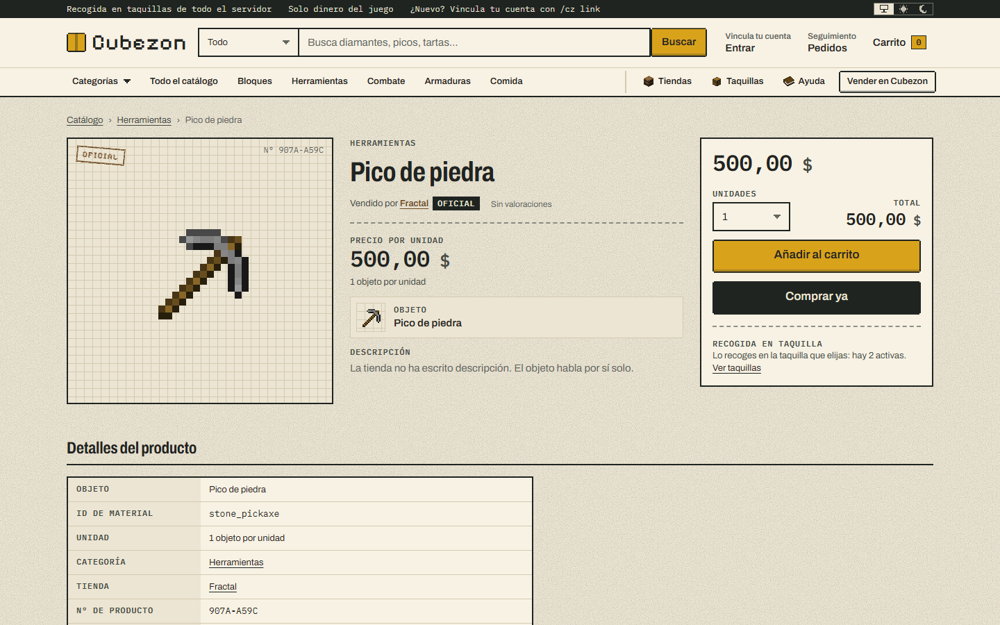
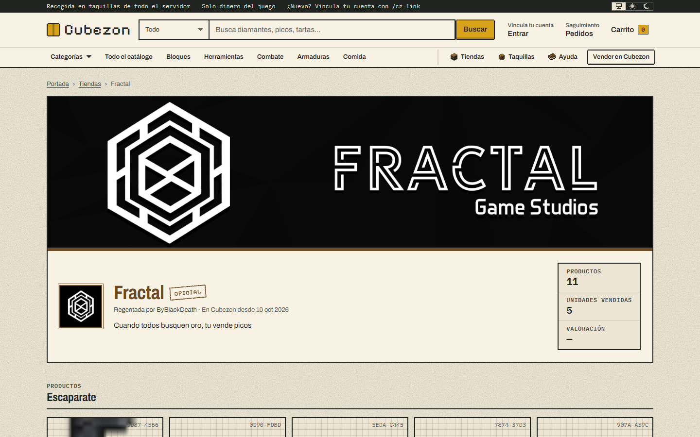
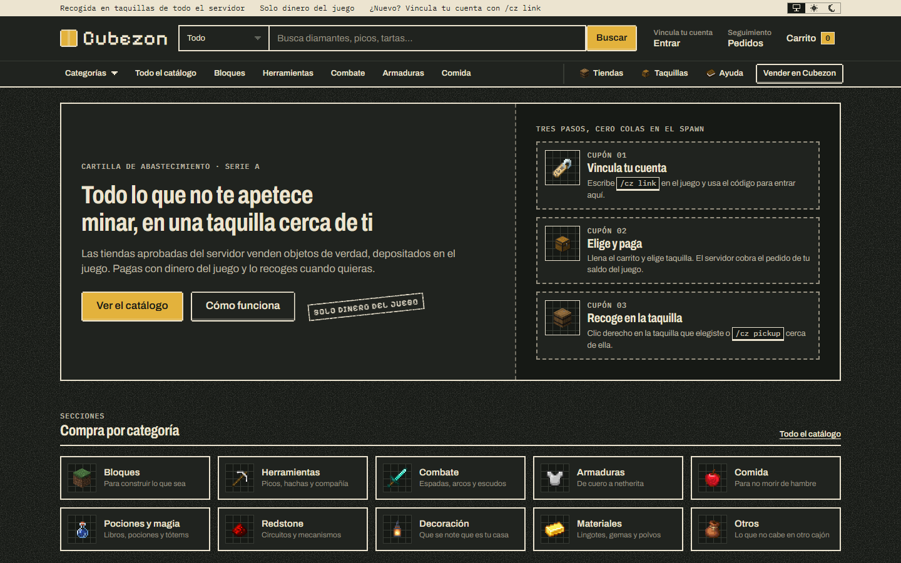

# Cubezon

[English](../../README.md) · **Español**

Un marketplace parodia para un servidor de Minecraft. Las tiendas de jugadores aprobadas venden objetos del juego por dinero del juego desde una web, y el comprador recoge su pedido en una taquilla (o en su propio buzón) dentro del juego.

> Proyecto de portfolio. Sin relación con Amazon ni con Mojang. Solo se usa dinero del juego.

[](https://github.com/IOxee/Cubezon/actions/workflows/ci.yml)



<table>
  <tr>
    <td></td>
    <td></td>
  </tr>
  <tr>
    <td></td>
    <td></td>
  </tr>
</table>

## Cómo funciona

```
 Web (Next.js)                 Supabase (PostgreSQL)              Plugin Paper (Java)
 ─────────────                 ─────────────────────              ───────────────────
 catálogo, carrito, caja ───►  orders: PENDING          ◄───────  consulta pedidos pendientes
                                                                  cobra al comprador (Vault)
                               orders: PAID → READY     ◄───────  reserva stock, paga al vendedor
 seguimiento del pedido  ◄───  order_events (trigger)
                               orders: COLLECTED        ◄───────  el jugador abre la taquilla
```

- **El plugin es la única autoridad sobre dinero y objetos.** La web solo puede crear pedidos `PENDING`; nunca toca saldos, inventarios ni el depósito (escrow).
- **Solo hay stock si se ha depositado.** Los vendedores meten objetos reales en el juego (`/cz deposit`); nunca se crean objetos de la nada.
- **Antes perder que duplicar.** Los pedidos se reclaman, se cobran y se completan en pasos separados; un pedido interrumpido se marca como fallido al arrancar y queda registrado para revisarlo, en lugar de cobrarse dos veces. El pago al vendedor se marca antes de pagar, así que un fallo puede dejarlo pendiente, pero nunca paga dos veces.
- **Row Level Security en todas las tablas.** La clave pública (publishable) solo lee tiendas aprobadas, productos activos, taquillas y vistas públicas. La clave secreta se queda en el servidor.

## Funcionalidades

**Compradores (web)**
- Catálogo con búsqueda, filtros y categorías, fichas de producto, escaparates de tienda y valoraciones.
- Carrito, caja y seguimiento del pedido en directo (`PENDING → PAID → READY → COLLECTED`, más `FAILED`/`REFUNDED`).
- Inicio de sesión con un código de un solo uso generado en el juego (`/cz link`), sin contraseñas.
- Entrega en una taquilla pública o envío exprés al buzón del comprador.

**Vendedores**
- Varias tiendas por jugador (cupo configurable) y empleados con rangos y permisos detallados.
- Gestión de productos desde la web o desde un «Ordenador de empresa» dentro del juego.
- Zonas de tienda en el mundo, con bloques de almacén que fijan cuánto stock puede guardar la tienda.
- Objetos personalizados de ItemsAdder, MMOItems, CraftEngine y otros plugins (detectados por reflexión o por claves PDC).

**Modos de pedido** (en `config.yml`)
- `automatic`: el plugin cobra y prepara cada pedido por sí solo.
- `roleplay`: el personal de la tienda acepta o rechaza los pedidos en su ordenador, imprime un paquete y lo lleva en persona a la taquilla.

**Administración**
- Aprobación de tiendas, taquillas, jugadores y cupos de tiendas, equipo y pedidos en solo lectura.
- Temas de temporada con comprobación automática de contraste WCAG.

## Tecnologías

| Parte | Stack |
| --- | --- |
| `plugin/` | Paper 1.21.11, Java 21, Gradle (Kotlin DSL), Vault API, HikariCP, JUnit 6 |
| `web/` | Next.js 16 (App Router, Cache Components), React 19, TypeScript, Tailwind CSS 4, Vitest |
| `supabase/` | PostgreSQL en Supabase: migraciones versionadas, RLS, triggers y funciones RPC, buckets de Storage |

## Estructura del repositorio

```
plugin/               Plugin Paper (pedidos, escrow, taquillas, buzones, almacenes, ordenador roleplay)
web/                  Marketplace Next.js, panel de vendedor y administración
supabase/migrations/  Esquema SQL, compartido por el plugin y la web
docs/                 Notas de arquitectura de la web, datos de objetos y capturas
.github/workflows/    CI: build y JUnit del plugin, lint, typecheck y Vitest de la web
DESIGN.md             Sistema de diseño visual de la web («Cartilla», en inglés)
AGENTS.md             Reglas de dominio y convenciones para agentes de código (en inglés)
MEMORY.md             Notas de trabajo entre sesiones
```

## Puesta en marcha

### Requisitos

- Java 21, Node.js 20+ y npm
- Un proyecto de [Supabase](https://supabase.com) (basta con el plan gratuito)
- Un servidor Paper 1.21.11 con [Vault](https://www.spigotmc.org/resources/vault.34315/) y un plugin de economía (p. ej. EssentialsX)

### 1. Base de datos

```bash
npx supabase link --project-ref <tu-project-ref>
npx supabase db push
```

Crea todo el esquema, las políticas RLS y los buckets de Storage `shop-media` e `item-icons`.

### 2. Variables de entorno

Copia [`.env.example`](../../.env.example) a `.env` (lo usa el servidor de pruebas del plugin) y a `web/.env.local`, y rellena la URL y las claves de tu proyecto de Supabase. Nunca subas los archivos reales.

El plugin usa la conexión directa o el **session pooler** (puerto 5432), no el transaction pooler (6543).

### 3. Plugin

```bash
cd plugin
./gradlew build
```

Copia `plugin/build/libs/cubezon-plugin-<versión>.jar` a la carpeta `plugins/` del servidor. La base de datos se activa sola si está definida `CUBEZON_DB_URL` (o configúrala en `plugins/Cubezon/config.yml`).

### 4. Web

```bash
cd web
npm install
npm run dev
```

Abre http://localhost:3000, entra en el servidor, usa `/cz link` e inicia sesión con el código. Para hacerte el primer superadmin, ejecuta esto en el editor SQL de Supabase después de haber entrado una vez al servidor:

```sql
insert into public.staff (player_uuid, role)
select uuid, 'SUPERADMIN' from public.players where name = '<TuNombreDeJugador>';
```

## Comandos del juego

`/cubezon` (alias `/cz`):

| Comando | Quién | Qué hace |
| --- | --- | --- |
| `link` | todos | Código de un solo uso para entrar en la web |
| `deposit` | vendedores | Meter stock en un producto |
| `pickup` | todos | Recoger los pedidos listos en una taquilla cercana |
| `storage [buy\|give\|type ...]` | vendedores / admins | Bloques y tipos de almacén |
| `computer buy\|give` | vendedores / admins | Ordenador de empresa (modo roleplay) |
| `mailbox [buy\|give]` | todos | Buzón personal para el envío exprés |
| `employee add\|remove\|list` | dueños de tienda | Contratar, despedir y listar empleados |
| `item info\|register` | todos / admins | Ver la clave del objeto en la mano / registrarlo en el catálogo web |
| `locker create\|remove\|list` | admins | Taquillas de recogida |
| `shop <slug\|id>`, `shop settings slots ...` | admins | Palo de zona de tienda, cupos de tiendas |
| `reload` | admins | Recargar la configuración y los mensajes |

Los textos para el jugador están en español, en `plugin/src/main/resources/lang/es.yml` y `web/src/i18n/`.

## Tests

```bash
cd plugin && ./gradlew test
cd web && npm test && npm run typecheck && npm run lint
```

## Licencia

[MIT](../../LICENSE)
